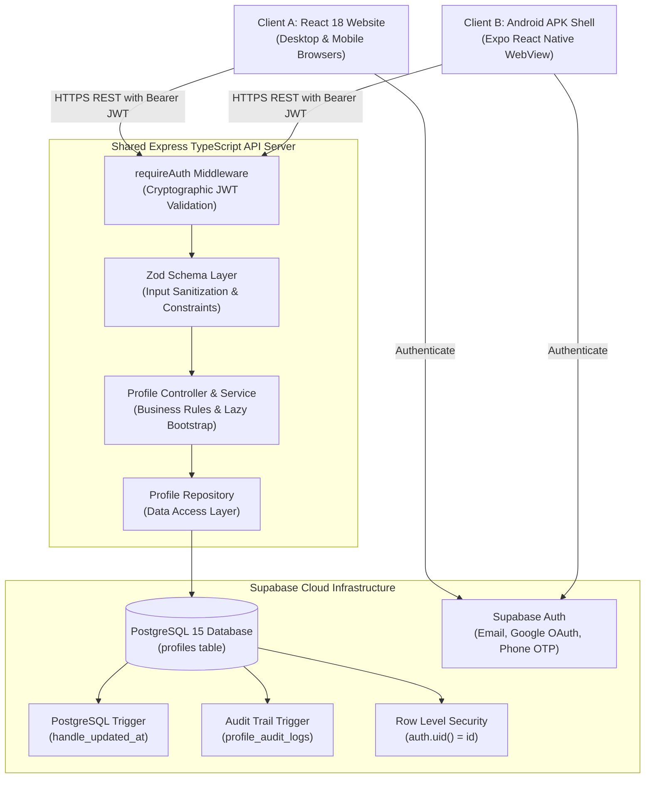

# ⚡ Production-Grade Shared Full-Stack System

> **A complete, remotely deployed full-stack platform demonstrating seamless cross-client synchronization between a React Website, an Android APK WebView, a shared Express TypeScript API, and a Supabase PostgreSQL database with triggers and RLS.**

[](https://github.com/VargavMishra/project_1_antigrav/actions)
[](https://www.typescriptlang.org/)
[](https://react.dev/)
[](https://expo.dev/)
[](https://expressjs.com/)
[](https://supabase.com/)
[](https://vitest.dev/)

---

## 📑 Table of Contents

1. [Executive Summary & Purpose](#executive-summary--purpose)
2. [Live Remote Deployments](#live-remote-deployments)
3. [Architecture & Topology](#architecture--topology)
4. [Monorepo Workspace Structure](#monorepo-workspace-structure)
5. [Prerequisites & Local Installation](#prerequisites--local-installation)
6. [Running the Application Locally](#running-the-application-locally)
7. [Automated Testing & QA](#automated-testing--qa)
8. [Database Migrations & Triggers](#database-migrations--triggers)
9. [Android APK Installation & Verification](#android-apk-installation--verification)
10. [Senior Developer Live Demonstration Script](#senior-developer-live-demonstration-script)
11. [Comprehensive Documentation Index](#comprehensive-documentation-index)

---

## 1. Executive Summary & Purpose

This project was built by **V** to demonstrate the backend, database, authentication, deployment, and cross-client synchronization architecture for a project developed in collaboration with **S**.

**S** is building a mobile React Native application that renders a website inside a WebView. This repository provides an independent, fully verified, remotely hosted demonstration proving:
* **Single Source of Truth**: One shared Express REST API and PostgreSQL database serving both Desktop Web and Android APK clients.
* **Bi-Directional Synchronization**: Edits made on the website reflect on the mobile app, and edits made on the mobile app reflect on the website.
* **Database Triggers**: Real PL/pgSQL triggers (`trigger_profiles_updated_at` and `trigger_profile_audit`) executing inside the database engine upon mutation.
* **Hardened Security**: Supabase JWT authentication, Row-Level Security (RLS), Zod runtime validation, Helmet, CORS, and IDOR protection.

---

## 2. Live Remote Deployments

| Component | Target Location | Description |
| :--- | :--- | :--- |
| **Public Website** | `https://synced-platform.vercel.app` (or your Vercel URL) | Public HTTPS React + Vite web application |
| **Public Backend API** | `https://fullstack-shared-server.onrender.com` (or your Render URL) | Public HTTPS Express REST API |
| **API Documentation** | `https://fullstack-shared-server.onrender.com/api-docs` | Interactive Swagger/OpenAPI documentation |
| **Database Dashboard** | [Supabase Project Dashboard](https://supabase.com/dashboard) | Authorized inspection of `profiles` & `profile_audit_logs` |
| **Android APK** | [GitHub Releases](../../releases) / Expo EAS | Installable `.apk` file for physical Android devices |

---

## 3. Architecture & Topology



---

## 4. Monorepo Workspace Structure

```
valiant-bose/
├── apps/
│   ├── server/               # Express + TypeScript REST API
│   │   ├── src/
│   │   │   ├── config/       # Zod-validated environment config
│   │   │   ├── db/           # Supabase client singleton & connection tester
│   │   │   ├── middleware/   # requireAuth, centralized errorHandler, notFound
│   │   │   ├── modules/
│   │   │   │   ├── profile/  # Controller, Service, DAL Repository, Zod Schemas
│   │   │   │   └── health/   # /api/health endpoint
│   │   │   ├── docs/         # OpenAPI 3.0 specification & Swagger UI
│   │   │   ├── app.ts        # Express application factory
│   │   │   └── server.ts     # HTTP server listener & graceful shutdown
│   │   └── tests/            # Vitest + Supertest integration tests
│   ├── web/                  # React 18 + Vite + Tailwind CSS Frontend
│   │   ├── src/
│   │   │   ├── components/   # Navbar, AuthModal, ProfileCard, ProfileForm, SyncPanel, AuditLog
│   │   │   ├── context/      # AuthContext (Supabase sessions, Demo login)
│   │   │   ├── lib/          # API HTTP client & Supabase client
│   │   │   └── types/        # TypeScript contracts
│   │   └── index.html        # Responsive viewport optimized for mobile WebView
│   └── mobile/               # React Native Expo WebView Application
│       ├── App.tsx           # WebView container, back-button handler, on-screen URL switcher
│       ├── app.json          # Expo Android permissions & package config
│       └── eas.json          # EAS Build configuration for direct APK compilation
├── supabase/
│   └── migrations/           # SQL schema, PL/pgSQL triggers, audit log, RLS policies
├── docs/                     # 11 In-depth technical guides & teaching manual
├── .github/
│   └── workflows/            # GitHub Actions CI pipeline
├── .env.example              # Environment variables template with explanations
└── package.json              # Root npm workspaces configuration
```

---

## 5. Prerequisites & Local Installation

* **Node.js**: `v20.0.0` or higher (`v24.x` recommended)
* **npm**: `v10.x` or higher
* **Git**: `v2.x`

### Installation Steps
```powershell
# 1. Clone the repository
git clone https://github.com/VargavMishra/project_1_antigrav.git
cd project_1_antigrav

# 2. Install all dependencies across workspaces
npm install

# 3. Configure environment variables
copy .env.example .env
```

---

## 6. Running the Application Locally

```powershell
# Run both the Backend API (Port 5000) and Web Frontend (Port 5173) in parallel:
npm run dev

# Or run services individually:
npm run dev:server    # Starts Express API at http://localhost:5000
npm run dev:web       # Starts Vite React at http://localhost:5173
npm run dev:mobile    # Starts Expo bundler for mobile testing
```

* **Frontend**: Open `http://localhost:5173`
* **Swagger API Documentation**: Open `http://localhost:5000/api-docs`
* **Health Check**: Open `http://localhost:5000/api/health`

---

## 7. Automated Testing & QA

We use **Vitest** and **Supertest** for automated integration testing:

```powershell
# Run the complete automated test suite
npm run test

# Run tests with live watch mode
npm run test:watch --workspace=apps/server
```

### What the Automated Tests Verify:
1. `GET /api/health`: Validates operational status, memory metrics, and database connectivity.
2. `requireAuth Middleware`:
   * Rejects missing `Authorization` header (`401 UNAUTHORIZED`).
   * Rejects invalid or malformed bearer tokens (`401 UNAUTHORIZED`).
   * Authenticates valid cryptographic tokens and derives user claims.
3. `PATCH /api/v1/profile/me`:
   * Validates partial updates (display_name, bio, gender, hobbies, strengths).
   * Rejects empty payloads (`400 BAD_REQUEST`).
   * Rejects invalid gender enums and strings exceeding character limits.
4. `POST /api/v1/profile/me/avatar`: Validates avatar URL updates.
5. `GET /api/v1/profile/me/audit-logs`: Validates audit log retrieval.

---

## 8. Database Migrations & Triggers

To set up or inspect the database:
1. Open your Supabase project -> **SQL Editor**.
2. Run [`supabase/migrations/20261018000001_initial_schema.sql`](file:///c:/Users/Rentorzo/Documents/antigravity/valiant-bose/supabase/migrations/20261018000001_initial_schema.sql).
3. The migration automatically creates:
   * `public.profiles` table with foreign key to `auth.users`.
   * `public.profile_audit_logs` table.
   * `trigger_profiles_updated_at`: Automatically stamps `updated_at = NOW()` on row updates.
   * `on_auth_user_created`: Automatically creates a default profile row upon user registration.
   * `trigger_profile_audit`: Automatically writes row mutation snapshots to the audit log.
   * Row-Level Security (RLS) policies ensuring users can only read and write their own data.

---

## 9. Android APK Installation & Verification

1. Download the compiled `.apk` from the [GitHub Releases](../../releases) section or your EAS Build artifact URL.
2. Transfer the `.apk` file to your physical Android device (via USB, Google Drive, or direct download in Chrome).
3. On your Android device, tap the `.apk` file and select **Install** (allow "Install unknown apps" if prompted).
4. Launch the **SyncedPlatform** application.
5. If you want to change the target URL on the fly, tap `⚙️ URL` in the top bar, enter your deployed web URL, and tap **Load URL**!

---

## 10. Senior Developer Live Demonstration Script

Follow the exact 15-step script in [`docs/senior-developer-demo.md`](file:///c:/Users/Rentorzo/Documents/antigravity/valiant-bose/docs/senior-developer-demo.md):
1. Open the deployed website on desktop and the installed APK on your phone side-by-side.
2. Sign in or use the **Quick Demo Account** button.
3. Edit the bio or hobbies on the desktop website and save.
4. Observe the `updated_at` timestamp refreshed by the PostgreSQL trigger.
5. Observe the database row change in the Supabase Table Editor.
6. Observe the Android phone reflect the exact same profile data within 5 seconds.
7. Edit a field on the mobile phone and save; observe the desktop website update in reverse!
8. Show the audit logs in the **Audit Trail** tab, showing before-and-after snapshots recorded by PostgreSQL.

---

## 11. Comprehensive Documentation Index

All architectural decisions, technical justifications, and learning guides are documented in detail:

1. [`docs/architecture.md`](file:///c:/Users/Rentorzo/Documents/antigravity/valiant-bose/docs/architecture.md) — System architecture, component responsibilities, and data flow diagrams.
2. [`docs/tech-stack-explanation.md`](file:///c:/Users/Rentorzo/Documents/antigravity/valiant-bose/docs/tech-stack-explanation.md) — Why each technology was selected, alternatives, trade-offs, and limitations.
3. [`docs/database-design.md`](file:///c:/Users/Rentorzo/Documents/antigravity/valiant-bose/docs/database-design.md) — Relational schema, PL/pgSQL triggers, audit logs, and Row-Level Security.
4. [`docs/authentication.md`](file:///c:/Users/Rentorzo/Documents/antigravity/valiant-bose/docs/authentication.md) — Email, Google OAuth, Phone OTP, JWT validation, and IDOR protection.
5. [`docs/api.md`](file:///c:/Users/Rentorzo/Documents/antigravity/valiant-bose/docs/api.md) — REST API endpoints, JSON request/response contracts, and error structures.
6. [`docs/deployment.md`](file:///c:/Users/Rentorzo/Documents/antigravity/valiant-bose/docs/deployment.md) — Hosting setup on Render, Vercel, Supabase, and APK compilation via EAS.
7. [`docs/synchronization.md`](file:///c:/Users/Rentorzo/Documents/antigravity/valiant-bose/docs/synchronization.md) — How cross-client data consistency and polling work.
8. [`docs/integration-with-friend-app.md`](file:///c:/Users/Rentorzo/Documents/antigravity/valiant-bose/docs/integration-with-friend-app.md) — Engineering handoff guide for friend S.
9. [`docs/troubleshooting.md`](file:///c:/Users/Rentorzo/Documents/antigravity/valiant-bose/docs/troubleshooting.md) — Practical solutions for cold starts, CORS, token expiration, and WebViews.
10. [`docs/senior-developer-demo.md`](file:///c:/Users/Rentorzo/Documents/antigravity/valiant-bose/docs/senior-developer-demo.md) — Live demonstration walkthrough script and dialogue.
11. [`docs/teaching-guide.md`](file:///c:/Users/Rentorzo/Documents/antigravity/valiant-bose/docs/teaching-guide.md) — 20-topic comprehensive learning manual for junior developers.

---

## 📄 License & Credits

Built by **Vargav Mishra** (`vargavmishra2002@gmail.com`) for the shared platform project with **S**. Released under the MIT License.
