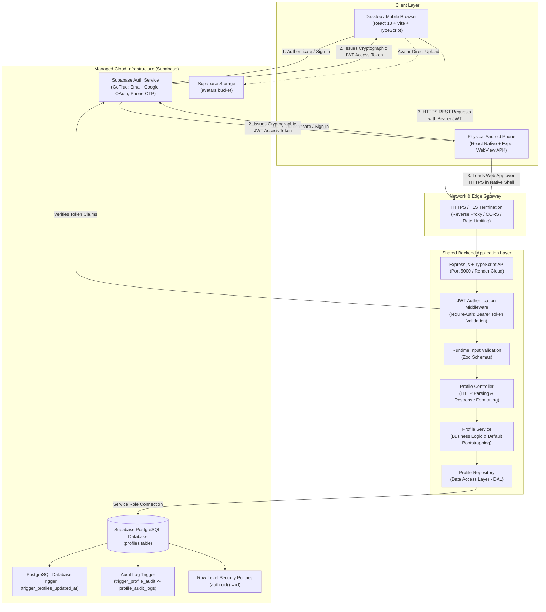

# System Architecture & Component Responsibilities

## 1. High-Level Architectural Overview

The system is designed around a **Single Source of Truth** pattern where multiple heterogeneous clients (Desktop Web, Mobile Web, and Android APK WebView) interface with a shared RESTful API backend and a centralized PostgreSQL relational database managed by Supabase.

---

## 2. Component Responsibilities

### 2.1 Web Application (`apps/web`)
* **Technology**: React 18, Vite, TypeScript, Tailwind CSS, Lucide React.
* **Responsibilities**:
  * Renders a mobile-first, responsive user interface matching native mobile dimensions and desktop viewports.
  * Connects to Supabase Auth on the client side to manage authentication sessions, email confirmation, phone OTP verification, and Google OAuth redirects.
  * Derives access tokens from local session storage and attaches them to HTTP `Authorization: Bearer <token>` headers for all backend API calls.
  * Manages real-time polling and synchronization telemetry, allowing the user to observe background sync events.
  * Contains zero database connection strings or secret keys.

### 2.2 Mobile Android Application (`apps/mobile`)
* **Technology**: React Native, Expo SDK 52, `react-native-webview`.
* **Responsibilities**:
  * Compiles into a standalone Android Package (`.apk`) installable directly on physical Android hardware.
  * Embeds the web experience inside a native Android container using `react-native-webview`.
  * Handles Android hardware back button events (`BackHandler`) to support in-app navigation history rather than closing the application unexpectedly.
  * Injects a standard mobile Chrome User Agent to bypass identity provider blocks against embedded WebViews during OAuth flows.
  * Provides an on-screen runtime URL switcher, enabling testing across localhost LAN IPs, staging URLs, and production domains without requiring a rebuild.

### 2.3 Shared Backend API (`apps/server`)
* **Technology**: Node.js, Express, TypeScript, Zod, Helmet, Morgan, Swagger UI.
* **Responsibilities**:
  * Acts as the authoritative gatekeeper for all profile modifications and business logic.
  * **Authentication Middleware (`requireAuth`)**: Cryptographically validates Supabase JWT tokens and extracts the user's verified identity (`req.user.id`). Never trusts client-supplied user IDs in URL parameters or request bodies.
  * **Validation Layer**: Uses Zod schemas to enforce strict types, character limits, string sanitization, and enum constraints before requests reach business logic.
  * **Separation of Concerns**: Enforces a strict 3-tier backend architecture:
    * `Controller`: Manages HTTP request parsing, status codes, and JSON responses.
    * `Service`: Encapsulates business logic, defaults, and orchestration.
    * `Repository`: Data Access Layer (DAL) executing database queries.
  * Exposes interactive OpenAPI 3.0 documentation at `/api-docs`.

### 2.4 Persistent Database & Auth Infrastructure (`Supabase PostgreSQL`)
* **Technology**: PostgreSQL 15+, PL/pgSQL Triggers, Row-Level Security (RLS).
* **Responsibilities**:
  * Stores user profiles with relational constraints, foreign keys referencing `auth.users(id)`.
  * **Automatic `updated_at` Trigger (`trigger_profiles_updated_at`)**: Automatically updates the `updated_at` column in PostgreSQL whenever a profile row changes, guaranteeing accuracy regardless of which client executed the update.
  * **User Registration Trigger (`on_auth_user_created`)**: Bootstraps an initial profile record immediately upon user signup in Supabase Auth.
  * **Audit Log Trigger (`trigger_profile_audit`)**: Records every insertion, mutation, and deletion in `profile_audit_logs` with before-and-after JSON snapshots.
  * **Row-Level Security (RLS)**: Enforces database-level authorization policies preventing unauthorized direct queries.

---

## 3. Data Flow: Profile Update Lifecycle

1. **User Action**: The user edits their bio or hobbies in the form and clicks **Save Profile Changes**.
2. **Frontend Validation**: React performs optimistic validation and prepares the payload.
3. **HTTP Dispatch**: The frontend calls `PATCH /api/v1/profile/me` with header `Authorization: Bearer <jwt_token>`.
4. **Security & Rate Limiting**: Express checks rate limits (`express-rate-limit`) and security headers (`helmet`).
5. **Authentication Verification**: `requireAuth` middleware verifies the JWT against Supabase Auth. It extracts the claims and populates `req.user = { id: '...' }`.
6. **Payload Validation**: Zod parses `req.body` against `updateProfileSchema`. If validation fails, it aborts with HTTP 400 and structured field error details.
7. **Business Processing**: `ProfileService.updateProfile` receives the verified user ID and validated fields.
8. **Data Access**: `ProfileRepository.update` executes the SQL query against PostgreSQL.
9. **Database Trigger Execution**:
   * PostgreSQL fires `trigger_profiles_updated_at` BEFORE UPDATE, resetting `updated_at = NOW()`.
   * PostgreSQL fires `trigger_profile_audit` AFTER UPDATE, creating an immutable audit record in `profile_audit_logs`.
10. **Response Dispatch**: The backend responds with HTTP 200 OK and the complete updated profile record.
11. **Cross-Client Sync**: Other active clients (e.g. the Android APK or second browser window) poll or refetch the API, receiving the new data within seconds.
