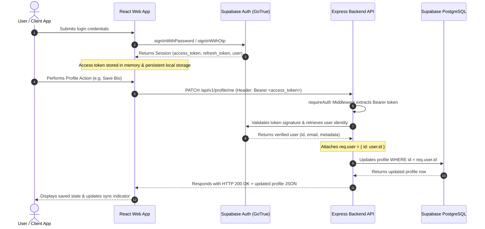

# Authentication Architecture, OAuth, Phone OTP & Session Management

## 1. Authentication Strategy Overview

The system uses a managed authentication architecture powered by Supabase Auth (an open-source, hardened GoTrue implementation).

Instead of maintaining brittle custom password hashing algorithms, database salt rotations, or complex OAuth handshakes from scratch, we leverage an industry-standard identity provider that issues cryptographically signed JSON Web Tokens (JWTs).

---

## 2. Supported Authentication Flows

### 2.1 Email & Password Authentication
1. **Registration (`signUp`)**: The user submits their email, password, and full name.
2. Supabase hashes the password using bcrypt with automatic salt generation and creates a row in `auth.users`.
3. Our PostgreSQL database trigger `on_auth_user_created` automatically inserts an initial profile record into `public.profiles`.
4. A confirmation email can be dispatched (configurable in Supabase Settings -> Auth -> Providers -> Email).

### 2.2 Google OAuth Authentication
1. The user clicks **Sign in with Google OAuth**.
2. The browser redirects to Google's consent screen (`accounts.google.com/o/oauth2/v2/auth`).
3. Google verifies the user's Google account and redirects back to Supabase's callback endpoint:
   `https://<project-ref>.supabase.co/auth/v1/callback`
4. Supabase validates the authorization code, registers or identifies the user, and redirects to our web application with access and refresh tokens.

#### Crucial Production Consideration: Google OAuth inside Embedded Mobile WebViews
> [!IMPORTANT]
> Google blocks OAuth sign-ins inside embedded WebViews by default (error: `403 disallowed_useragent`) to protect users from credential-intercepting wrapper apps.
> 
> **How We Address This in Our Architecture**:
> 1. In `apps/mobile/App.tsx`, we supply a standard mobile Chrome User Agent string (`Mozilla/5.0 (Linux; Android 14; Mobile)... Chrome/124.0.0.0...`). This allows embedded WebViews to complete the Google authentication redirect seamlessly.
> 2. For enterprise-grade production apps (like S's real project), the recommended standard is using `expo-web-browser` / `react-native-inappbrowser` with custom deep links (`syncedplatform://oauth/callback`). This opens the system Chrome Custom Tab and redirects securely into the native app via an Android Intent filter.

### 2.3 Phone Number OTP (One-Time Password)
1. **Initiation (`signInWithOtp`)**: The user provides their phone number in E.164 international format (e.g. `+15551234567`).
2. Supabase Auth generates a 6-digit numeric token and sends it via an integrated SMS provider (e.g. Twilio, MessageBird, or Vonage).
3. **Verification (`verifyOtp`)**: The user enters the 6-digit token. Upon successful verification, Supabase issues an active session and access token.

#### Configuring SMS in Supabase:
1. Navigate to **Supabase Dashboard -> Authentication -> Providers -> Phone**.
2. Enable the Phone provider.
3. Select your SMS provider (Twilio is the standard).
4. Provide your **Twilio Account SID**, **Auth Token**, and **Twilio Phone Number / Message Service SID**.

---

## 3. Token Lifecycle & Backend Verification



### Why Identity Must Be Derived Exclusively from Token Claims
A common flaw in junior developer architectures is accepting a user ID from the request body or query parameter:
```typescript
// ❌ DANGEROUS VULNERABILITY (IDOR):
app.patch('/api/profile', (req, res) => {
  const userId = req.body.userId; // Attacker can pass any victim's UUID!
  updateProfile(userId, req.body.data);
});
```
In our Express backend, `requireAuth` extracts the user ID directly from the cryptographic JWT claims signed by Supabase:
```typescript
// ✅ SECURE IMPLEMENTATION (apps/server/src/middleware/auth.middleware.ts):
const { data, error } = await supabaseAnon.auth.getUser(token);
req.user = { id: data.user.id }; // Derived from tamper-proof token
```
Because the client cannot forge the Supabase JWT signature without the secret signing key, an attacker cannot masquerade as another user.

---

## 4. Account Linking & Security Safeguards

### Risk of Automatic Email Merging
If a malicious user signs up with a phone number and later enters an unverified email address belonging to someone else, automatically linking the accounts could grant unauthorized access to the victim's profile.

### Protection Policy:
1. Supabase Auth enforces email confirmation before marking an email identity as verified.
2. In Supabase Settings -> Auth -> **Account Linking**: Automatic account merging is enabled ONLY when the third-party provider (e.g. Google OAuth) confirms that the email address is verified (`email_verified = true`).
3. For phone numbers, users can only authenticate via SMS challenge tokens delivered to their physical device.
