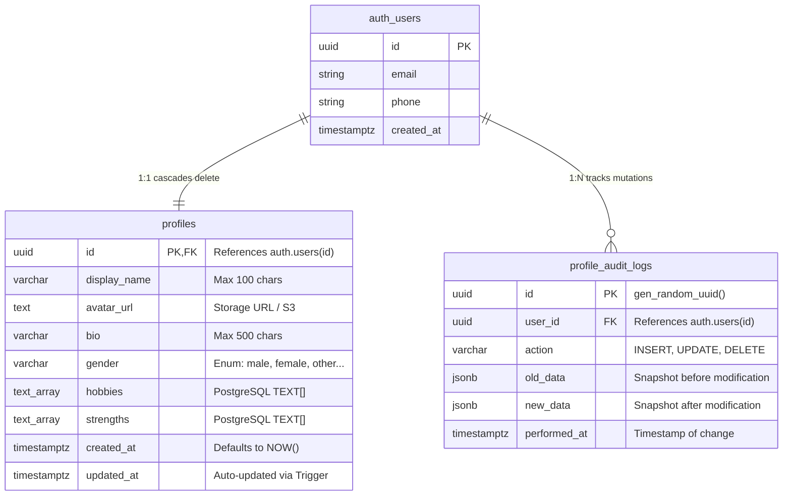

# Database Design, Schema, Triggers, and Security Policies

## 1. Relational Schema Architecture

The database is built on PostgreSQL 15+ hosted on Supabase. It uses a relational schema with foreign key cascades, triggers, and Row-Level Security (RLS).



---

## 2. Table Specifications

### 2.1 `public.profiles`
Stores user profile information synced across clients.
* `id` (`UUID`, PRIMARY KEY): Directly references `auth.users(id)` with `ON DELETE CASCADE`. This creates a strict 1-to-1 relationship between an authenticated user identity and their profile record.
* `display_name` (`VARCHAR(100)`, NOT NULL, DEFAULT `''`): The user's public display name.
* `avatar_url` (`TEXT`, DEFAULT `''`): Hosted URL or Supabase storage path of the user's avatar.
* `bio` (`VARCHAR(500)`, DEFAULT `''`): Short user biography.
* `gender` (`VARCHAR(50)`, DEFAULT `'unspecified'`): User gender selection.
* `hobbies` (`TEXT[]`, DEFAULT `ARRAY[]::TEXT[]`): Native PostgreSQL array of strings representing hobbies.
* `strengths` (`TEXT[]`, DEFAULT `ARRAY[]::TEXT[]`): Native PostgreSQL array of strings representing strengths.
* `created_at` (`TIMESTAMPTZ`, DEFAULT `NOW()`): Creation timestamp.
* `updated_at` (`TIMESTAMPTZ`, DEFAULT `NOW()`): Modification timestamp maintained automatically by our PostgreSQL trigger.

### 2.2 `public.profile_audit_logs`
Provides an immutable audit trail for security, compliance, and debugging.
* `id` (`UUID`, PRIMARY KEY): Auto-generated `gen_random_uuid()`.
* `user_id` (`UUID`, NOT NULL): References `auth.users(id)` with `ON DELETE CASCADE`.
* `action` (`VARCHAR(50)`, NOT NULL): Operation type (`'INSERT'`, `'UPDATE'`, `'DELETE'`).
* `old_data` (`JSONB`): Complete row state before modification.
* `new_data` (`JSONB`): Complete row state after modification.
* `performed_at` (`TIMESTAMPTZ`, DEFAULT `NOW()`): Timestamp when the SQL execution occurred.

---

## 3. Database Triggers (PL/pgSQL)

### 3.1 Automatic `updated_at` Timestamp Trigger
* **Objective**: Guarantees that `updated_at` is updated whenever a row is modified, regardless of whether the update came from our Express backend, a direct database query, or an administrative dashboard.
* **Function Definition**:
```sql
CREATE OR REPLACE FUNCTION public.handle_updated_at()
RETURNS TRIGGER AS $$
BEGIN
    NEW.updated_at = TIMEZONE('utc'::text, NOW());
    RETURN NEW;
END;
$$ LANGUAGE plpgsql SECURITY DEFINER;
```
* **Trigger Attachment**:
```sql
CREATE TRIGGER trigger_profiles_updated_at
    BEFORE UPDATE ON public.profiles
    FOR EACH ROW
    EXECUTE FUNCTION public.handle_updated_at();
```
* **How It Differs from an API Timestamp**: If an API sets `updated_at = req.body.updated_at`, an attacker or bug could backdate timestamps or forget to update them. A database trigger executes inside PostgreSQL's transaction engine, guaranteeing atomic consistency.

### 3.2 User Registration Bootstrap Trigger
* **Objective**: When a user registers via Email, Phone OTP, or Google OAuth, a profile record is automatically created in `public.profiles`.
```sql
CREATE OR REPLACE FUNCTION public.handle_new_user()
RETURNS TRIGGER AS $$
BEGIN
    INSERT INTO public.profiles (id, display_name, avatar_url, bio, gender, hobbies, strengths)
    VALUES (
        NEW.id,
        COALESCE(NEW.raw_user_meta_data->>'full_name', NEW.raw_user_meta_data->>'name', split_part(NEW.email, '@', 1), 'New User'),
        COALESCE(NEW.raw_user_meta_data->>'avatar_url', NEW.raw_user_meta_data->>'picture', ''),
        'Hello! I am using the full-stack synced platform.',
        'unspecified',
        ARRAY['Coding', 'Learning']::TEXT[],
        ARRAY['Problem Solving']::TEXT[]
    )
    ON CONFLICT (id) DO NOTHING;
    RETURN NEW;
END;
$$ LANGUAGE plpgsql SECURITY DEFINER;

CREATE TRIGGER on_auth_user_created
    AFTER INSERT ON auth.users
    FOR EACH ROW
    EXECUTE FUNCTION public.handle_new_user();
```

### 3.3 Audit Trail Trigger
* **Objective**: Automatically captures before-and-after snapshots of every profile update into `public.profile_audit_logs`.
```sql
CREATE OR REPLACE FUNCTION public.handle_profile_audit()
RETURNS TRIGGER AS $$
BEGIN
    IF (TG_OP = 'UPDATE') THEN
        INSERT INTO public.profile_audit_logs (user_id, action, old_data, new_data)
        VALUES (NEW.id, 'UPDATE', to_jsonb(OLD), to_jsonb(NEW));
        RETURN NEW;
    ELSIF (TG_OP = 'INSERT') THEN
        INSERT INTO public.profile_audit_logs (user_id, action, old_data, new_data)
        VALUES (NEW.id, 'INSERT', NULL, to_jsonb(NEW));
        RETURN NEW;
    ELSIF (TG_OP = 'DELETE') THEN
        INSERT INTO public.profile_audit_logs (user_id, action, old_data, new_data)
        VALUES (OLD.id, 'DELETE', to_jsonb(OLD), NULL);
        RETURN OLD;
    END IF;
    RETURN NULL;
END;
$$ LANGUAGE plpgsql SECURITY DEFINER;

CREATE TRIGGER trigger_profile_audit
    AFTER INSERT OR UPDATE OR DELETE ON public.profiles
    FOR EACH ROW
    EXECUTE FUNCTION public.handle_profile_audit();
```

---

## 4. Security Model: Authentication vs Authorization vs RLS

To explain to a senior developer:

1. **Authentication (AuthN)**: Answers *"Who are you?"* Handled by Supabase Auth (GoTrue), verifying credentials and issuing a signed JWT access token.
2. **API Authorization (AuthZ)**: Answers *"Are you allowed to execute this route?"* Handled by our Express `requireAuth` middleware, ensuring only valid tokens reach controllers.
3. **Row-Level Security (RLS)**: Answers *"Can this database role access this specific row in PostgreSQL?"* Handled directly by PostgreSQL's security kernel.

### Row-Level Security Policies Defined:
```sql
ALTER TABLE public.profiles ENABLE ROW LEVEL SECURITY;

-- 1. Users can ONLY view their own profile
CREATE POLICY "Users can view own profile"
    ON public.profiles FOR SELECT
    USING (auth.uid() = id);

-- 2. Users can ONLY update their own profile
CREATE POLICY "Users can update own profile"
    ON public.profiles FOR UPDATE
    USING (auth.uid() = id)
    WITH CHECK (auth.uid() = id);

-- 3. Users can ONLY insert their own profile
CREATE POLICY "Users can insert own profile"
    ON public.profiles FOR INSERT
    WITH CHECK (auth.uid() = id);
```

Even if someone steals an anon public key, they cannot query another user's profile row because PostgreSQL evaluates `auth.uid() = id` for every single row scanned!

---

## 5. Future Schema Extensibility Guide

When extending the platform for posts, comments, notifications, or preferences:

| Feature | Recommended Structure | Why? |
| :--- | :--- | :--- |
| **User Preferences** (theme, notifications toggle) | `JSONB` column on `profiles` | Flexible key-value settings that don't need SQL joins or indexing. |
| **Social Posts** | Separate table `posts (id, user_id, title, content, created_at)` | High-volume 1-to-many relationship requiring indexing, pagination, and foreign key cascades. |
| **Comments** | Separate table `comments (id, post_id, user_id, body, created_at)` | Relational child entity of posts with independent CRUD and moderation triggers. |
| **Tags / Categories** | Many-to-many join table `post_tags (post_id, tag_id)` | Allows indexing by tag and relational referential integrity. |
