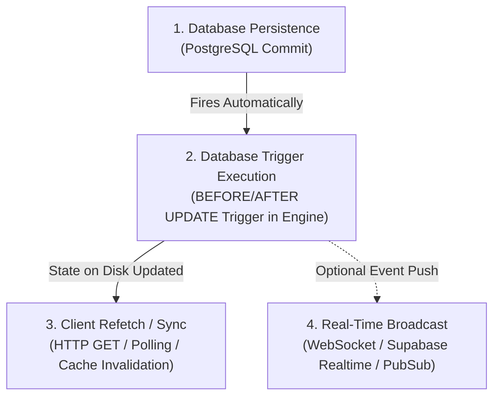
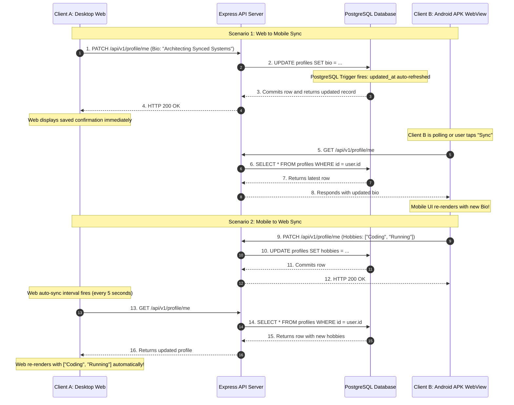

# Cross-Client Synchronization Architecture

## 1. The Core Engineering Challenge

A distributed application with multiple clients (Desktop Browser, Mobile Phone APK) accessing a shared database must address data consistency:
* If User V changes their bio on their laptop website, how does the mobile APK running on their phone display the new bio?
* If User V edits their hobbies inside the Android APK WebView, how does the desktop website reflect that change without stale data?

---

## 2. Four Fundamental Concepts Junior Developers Must Distinguish

When explaining this to a senior developer, you must clearly distinguish four distinct operations that beginners often conflate:



1. **Persisting Data in the Database**:
   * What it is: A SQL `UPDATE` statement executed within a database transaction and committed to non-volatile storage (disk / write-ahead log).
   * Where it happens: Supabase PostgreSQL server.
2. **Database Trigger Execution**:
   * What it is: A procedural PL/pgSQL function executed *inside the database engine* upon a table mutation event.
   * Key example: Our `trigger_profiles_updated_at` calculates and rewrites `NEW.updated_at = NOW()` immediately before the row write finishes. The client does NOT set this timestamp.
3. **Refreshing a Client Interface**:
   * What it is: A client application refetching data over HTTP (`GET /api/v1/profile/me`) and calling `setProfile(newData)` to trigger a React re-render.
4. **Real-Time Notification (Push vs Pull)**:
   * **Pull (Polling)**: The client periodically queries the backend (`setInterval` every 5 seconds). Simple, battle-tested, works across firewalls, proxies, and mobile sleeps.
   * **Push (WebSocket / SSE)**: The database publishes change events over a persistent TCP socket to subscribers. Higher efficiency for high-frequency collaborative apps, but requires connection resilience and reconnection backoff logic.

---

## 3. Two-Way Synchronization Flow



---

## 4. Why We Chose Periodic Polling for the Baseline Implementation

In our production demonstration:
1. **Zero Disconnection Dropouts**: Embedded mobile WebViews suspend background processes when the screen turns off or when the app is switched. WebSockets frequently drop or enter zombie states in mobile containers without complex keep-alive heartbeats.
2. **Predictable Observability**: By displaying the sync status ("Auto-polling active 5s", "Last fetched 12:30:15"), both the developer and the senior evaluator can see exactly when and how the client requests updates.
3. **Scalability Path**: When S's real application requires instant sub-second synchronization, Supabase Realtime can be enabled with a simple subscription hook:
```typescript
// Future Real-Time Upgrade:
supabase
  .channel('public:profiles')
  .on('postgres_changes', { event: 'UPDATE', schema: 'public', table: 'profiles' }, (payload) => {
    setProfile(payload.new as Profile);
  })
  .subscribe();
```
Because both polling and WebSockets query the exact same PostgreSQL table, introducing real-time subscriptions requires zero alterations to the backend data model!
